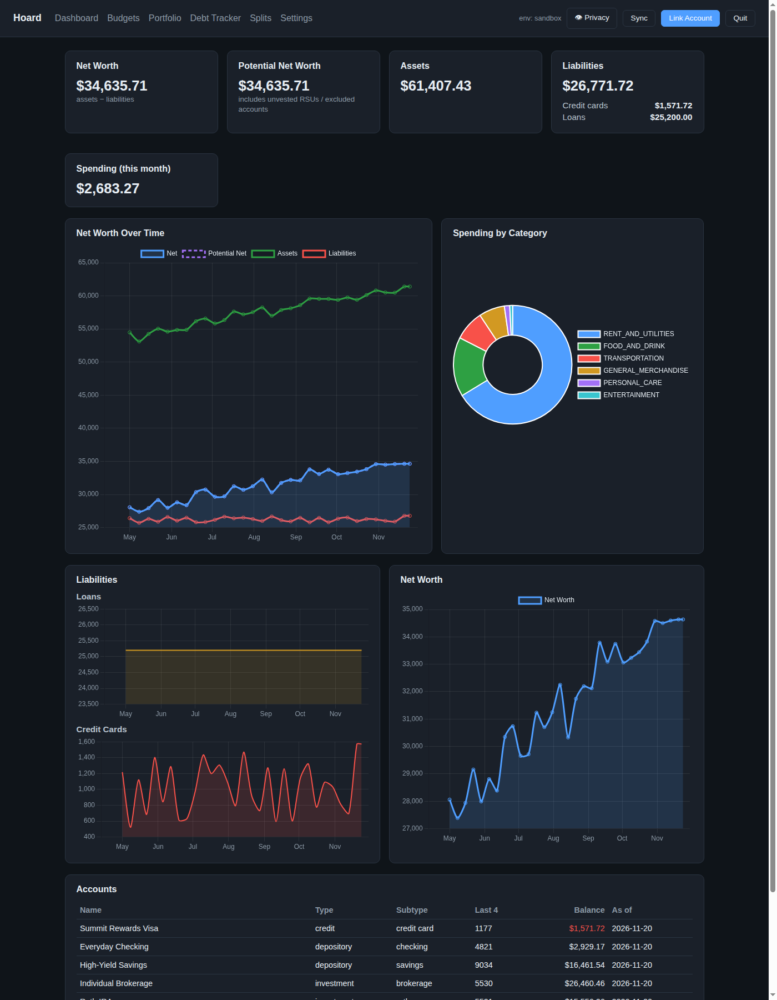
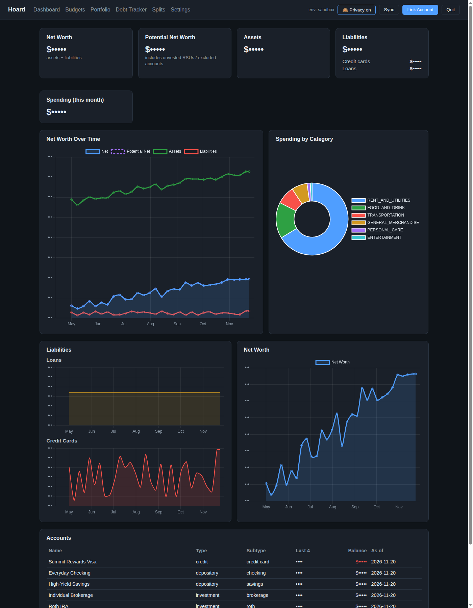
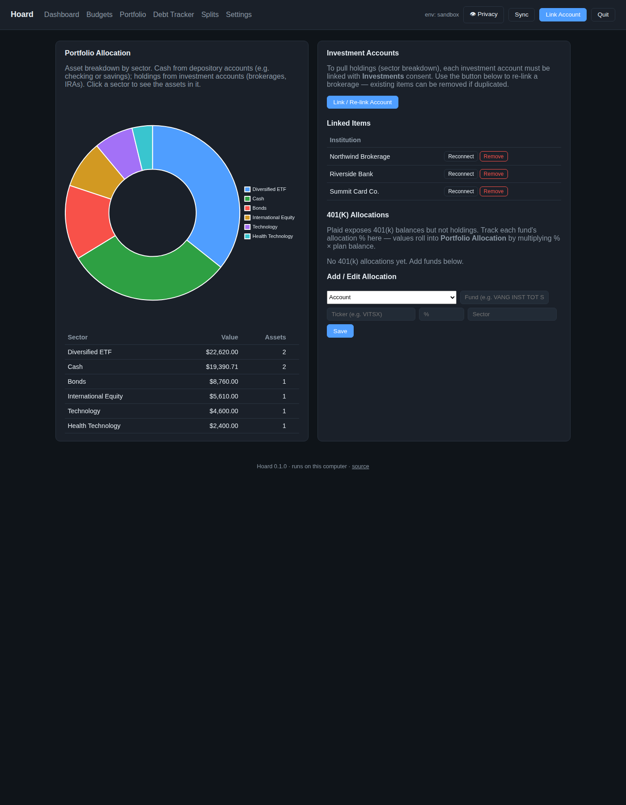

# Hoard

**Your finances, guarded on your own computer.**

Hoard is a private personal finance dashboard. It brings your bank accounts, credit cards,
investments and loans together in one place: net worth over time, spending by category,
budgets, portfolio allocation and debt payoff.

- **Private.** Hoard runs on your computer and keeps your data in a file there. No company
  account, no subscription, no one else's server.
- **Read-only.** Hoard can see balances and transactions. It can't move money or pay bills.
- **Bring your own Plaid keys.** Banks connect through [Plaid](https://plaid.com), using
  your own free Plaid account. The setup wizard walks you through it.



## Install

Hoard works on Windows, macOS and Linux. The installer sets everything up (including its
own copy of Python) and adds a **Hoard** shortcut. Run the same command again to update.

**Windows**: open PowerShell (Start menu, type "PowerShell") and paste:

```powershell
powershell -ExecutionPolicy Bypass -c "[Net.ServicePointManager]::SecurityProtocol = [Net.SecurityProtocolType]::Tls12; irm https://github.com/Woodwardbr/hoard/releases/latest/download/install.ps1 | iex"
```

**macOS or Linux**: open Terminal and paste:

```sh
curl -LsSf https://github.com/Woodwardbr/hoard/releases/latest/download/install.sh | sh
```

Then open **Hoard** from the Desktop, Start menu or Applications. It opens in your web
browser and walks you through setup: creating a free Plaid account, adding your keys, and
connecting your first bank. See [Getting started](docs/GETTING_STARTED.md) for the full
walkthrough.

## What you get

- **Dashboard**: net worth, assets and liabilities over time, and this month's spending.
- **Budgets**: monthly limits per category, with a month-vs-average view.
- **Portfolio**: your investments by sector across brokerages, with manual 401(k) fund
  breakdowns.
- **Debt Tracker**: loans, payments, balance history and payoff projections.
- **Splits**: assign card charges to a trip or group and track who owes you what.
- **Privacy mode**: one click hides every dollar amount, so you can show someone your
  spending mix or allocation without showing your numbers.
- **Automatic backups**: a daily copy of your data, keeping the last two weeks.
- **AI agents (optional)**: let Claude or other AI agents answer questions about your
  finances, read-only unless you allow more. See [docs/AGENT_API.md](docs/AGENT_API.md).

| Privacy mode | Portfolio |
|---|---|
|  |  |

## Your data and security

- Your data is a database file in your user data folder: `%LOCALAPPDATA%\hoard`
  (Windows), `~/Library/Application Support/hoard` (macOS) or `~/.local/share/hoard`
  (Linux). Backups are in `backups/` next to it.
- Your Plaid keys and bank connection tokens are kept in your computer's secure password
  storage (Windows Credential Manager, macOS Keychain, or the Linux keyring).
- Hoard only talks to Plaid (to sync your banks) and, if you turn it on, to AI agents you
  connect. It only answers requests from your own computer and refuses requests from other
  websites. There's no login, so don't expose it to a network.
- Privacy mode changes what's on screen, not the data: the numbers are still reachable in
  the browser's developer tools.

## Uninstall

Windows: in PowerShell, run
`powershell -ExecutionPolicy Bypass -c "[Net.ServicePointManager]::SecurityProtocol = [Net.SecurityProtocolType]::Tls12; irm https://github.com/Woodwardbr/hoard/releases/latest/download/uninstall.ps1 | iex"`. macOS/Linux:
`curl -LsSf https://github.com/Woodwardbr/hoard/releases/latest/download/uninstall.sh | sh`.
Your data is kept unless you ask to delete it (see the scripts in [install/](install/)).

## Contributing

Hoard is a Python (FastAPI) app. See [CONTRIBUTING.md](CONTRIBUTING.md) for development
setup, the project layout and how releases work.

## License

[MIT](LICENSE). Hoard isn't affiliated with Plaid or any bank. It's provided as-is; check
important numbers against your bank.
