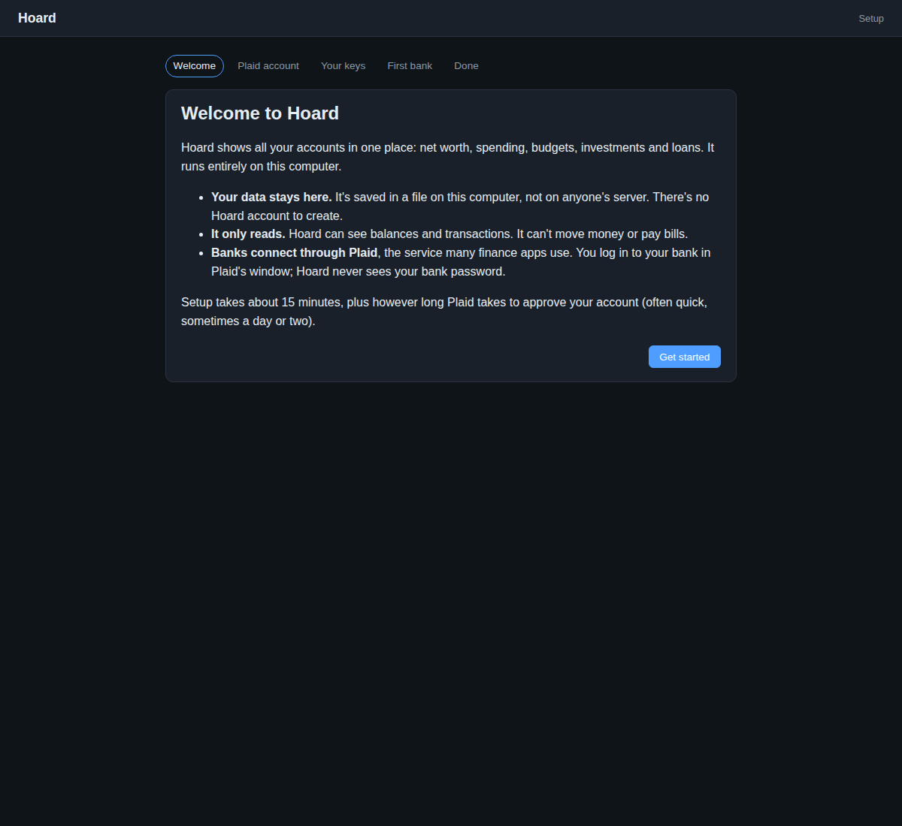

# Getting started with Hoard

This takes about 15 minutes, plus however long Plaid takes to approve your account
(often quick, sometimes a day or two). You don't need any technical background.

## 1. Install Hoard

**Windows**

1. Click the Start menu, type **PowerShell** and open it.
2. Copy this line, paste it into the PowerShell window (right-click pastes) and press Enter:

   ```powershell
   powershell -ExecutionPolicy Bypass -c "[Net.ServicePointManager]::SecurityProtocol = [Net.SecurityProtocolType]::Tls12; irm https://github.com/Woodwardbr/hoard/releases/latest/download/install.ps1 | iex"
   ```

3. Wait for **Done!**, then press Enter to close the window.

You'll now have **Hoard** on your Desktop and in the Start menu, plus **Update Hoard** in
the Start menu.

**macOS**

1. Open **Terminal** (press Cmd+Space, type "Terminal").
2. Paste this line and press Enter:

   ```sh
   curl -LsSf https://github.com/Woodwardbr/hoard/releases/latest/download/install.sh | sh
   ```

3. When it says **Done!**, open **Hoard** from the Applications folder in your home folder
   (Finder, Go, Home, Applications). You can drag it to the Dock.

**Linux**: same command as macOS; Hoard appears in your applications menu.

## 2. Open Hoard

Open the **Hoard** shortcut. Your web browser opens to Hoard's setup page. Hoard runs on
your computer; the browser is just how you see it. The address will be
`http://127.0.0.1:8000`, which means "this computer".



## 3. Create your free Plaid account

Plaid is the service many finance apps use to connect to banks. Hoard uses *your own* Plaid
account, so nobody else is in the middle.

1. Go to [dashboard.plaid.com/signup](https://dashboard.plaid.com/signup) and sign up with
   your email.
2. When asked how you'll use Plaid, choose **Personal use**.
3. Answer the short questionnaire. For example: *"I'm using Hoard, a personal finance app
   that runs on my own computer, to see my own accounts. Nobody else's data is involved."*
4. Once your account is ready, find your keys in the Plaid dashboard under **Developers**,
   then **Keys**. You need the **client_id** and the **Production secret**.

Plaid's free Trial plan allows up to 10 bank logins, which is plenty for a household. Keep
your secret private, like a password.

## 4. Add your keys

Back in Hoard, paste the client_id and secret and click **Save keys**. Hoard checks them
with Plaid, then saves them in your computer's secure password storage.

If Hoard says Plaid didn't accept them, check you copied the whole client_id and the
**Production** secret (Plaid also shows a Sandbox secret, which is for testing).

## 5. Connect your banks

Click **Add a bank**. Plaid opens a window where you search for your bank, log in with
your usual username and password (some banks open their own website for this), and choose
which accounts to share. Hoard never sees your bank password.

Hoard then pulls in your balances and recent transactions. Add as many banks, cards and
brokerages as you like.

## Using Hoard day to day

- Open Hoard and click **Sync** (top right) to get the latest from your banks.
- **Privacy** (top right) hides all dollar amounts, handy when someone's looking over your
  shoulder or you're sharing your screen.
- **Quit** (top right) stops Hoard. Your data is saved. Closing the browser tab alone
  leaves Hoard running in the background, which is harmless.
- If a bank asks you to log in again, go to **Settings** and click **Reconnect** next to it.

## Updating

- **Windows**: open **Update Hoard** from the Start menu.
- **macOS / Linux**: run the install command from step 1 again.

Your data and settings are kept.

## Troubleshooting

- **The browser didn't open**: go to `http://127.0.0.1:8000` yourself.
- **"This site can't be reached"**: Hoard isn't running. Open the Hoard shortcut.
- **Something went wrong**: Hoard writes a log that can help whoever is helping you:
  `hoard.log` in `%LOCALAPPDATA%\hoard` (Windows) or `~/Library/Logs/Hoard.log` (macOS).
- **Where's my data?** In `%LOCALAPPDATA%\hoard` (Windows),
  `~/Library/Application Support/hoard` (macOS) or `~/.local/share/hoard` (Linux), with
  daily backups in the `backups` folder there.
